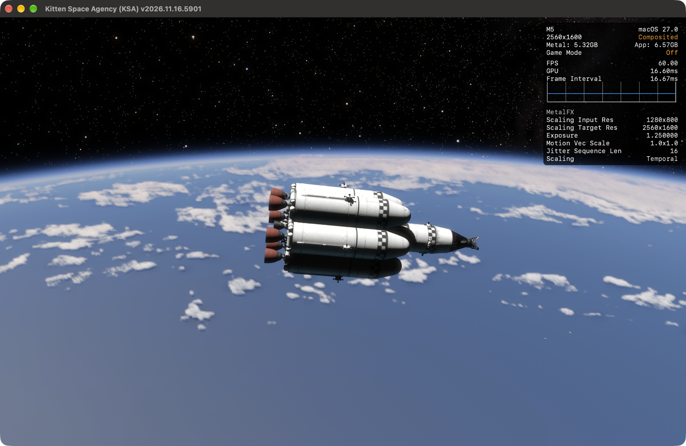
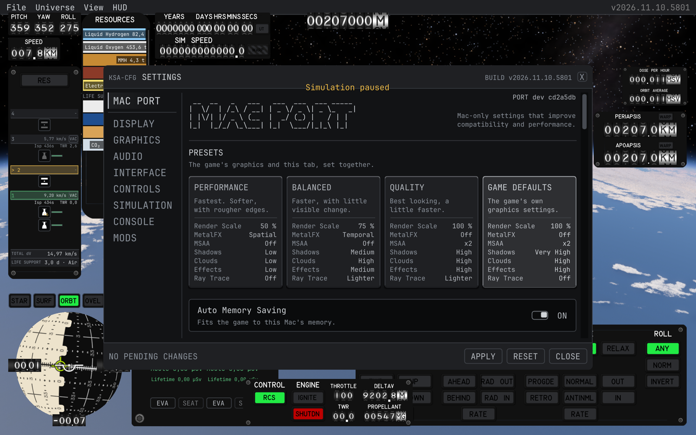

# Kitten Space Agency on Apple Silicon Macs

[](https://github.com/renancamm/ksa-macos-port/releases/latest)
[](#quick-start)
[](LICENSE)
[](https://github.com/renancamm/ksa-macos-port/releases)

An experimental community project that makes a native Mac app from the Linux version of **Kitten Space Agency**
(KSA), RocketWerkz's space flight game. It renders the game with **KSA Metal**, built around a Vulkan driver
written for KSA on top of Apple's Metal, with the game's tessellation, ray tracing and HDR, and optimizations for
Apple Silicon that make it faster with no visual changes. A **Mac Port** tab in the game's settings adds graphics
presets, MetalFX upscaling and memory savings.



> [!NOTE]
> This project is unofficial and not affiliated with RocketWerkz, and it doesn't include the game. KSA is free to
> download from [ksa.ahwoo.com](https://ksa.ahwoo.com); if you enjoy it, please consider supporting its development
> with a donation.

## Quick start

You need:

- A Mac with Apple Silicon (M1 or later) and **macOS 26** or later.
- The **Linux version of KSA** from [ksa.ahwoo.com](https://ksa.ahwoo.com). It is a file like
  `ksa_linux_v2026.11.10.5801.tar.gz`; leave it in your Downloads folder.

Then:

1. Download the port: the `ksa-macos-port-v….zip` of the
   [latest release](https://github.com/renancamm/ksa-macos-port/releases/latest), and unzip it.
2. In Terminal, go to the unzipped `ksa-macos-port` folder (the port folder) and run `port.sh`:
   ```bash
   cd ~/Downloads/ksa-macos-port
   ./port.sh
   ```
   It finds the KSA archive in Downloads and installs the app in about a minute.
3. Open **Kitten Space Agency** from `~/Applications`.

### Other commands

| Command | What it does |
|---|---|
| `./port.sh` | after a new KSA version is in Downloads: updates the game; saves and settings stay |
| `./port.sh --update` | updates the port to its latest release, then the app |
| `./port.sh <archive>` | makes the app from that KSA archive or extracted folder, even an older one |
| `./port.sh --app <path>` | makes or updates the app in another place |
| `./port.sh --help` | lists all the options |

### Where things are

- The app: `~/Applications/Kitten Space Agency.app`
- Saves, settings and logs: `~/Documents/My Games/Kitten Space Agency`
- Cache, several GB: `~/Library/Caches/Kitten Space Agency`

To uninstall, delete these and the port folder. Keep the Documents folder if you want your saves.

## How it works

KSA is a .NET 10 program built on [BRUTAL](https://github.com/ahwootech/BRUTAL), RocketWerkz's framework, and it
renders with Vulkan. Its .NET code runs on any platform; what ties the Linux release to Linux is the native code
under it. So the port does three things: it marks the game for Apple Silicon, swaps the Linux libraries for their
macOS builds, and plugs in a Vulkan driver made for KSA.

```text
 KSA's Linux release                              The Mac app
 ┌─────────────────────────────────┐              ┌─────────────────────────────────────┐
 │ The game                        │     kept     │ The game                            │
 │ KSA.dll, the .NET assemblies,   ├─────────────►│ the same files                      │
 │ Content/ with the shaders       │              │ + ARM64 mark: two bytes in KSA.dll  │
 └─────────────────────────────────┘              └─────────────────────────────────────┘
 ┌─────────────────────────────────┐              ┌─────────────────────────────────────┐
 │ .NET runtime                    │   swapped    │ .NET runtime                        │
 │ for Linux x64                   ├─────────────►│ Microsoft's build for macOS         │
 └─────────────────────────────────┘              └─────────────────────────────────────┘
 ┌─────────────────────────────────┐              ┌─────────────────────────────────────┐
 │ Native libraries                │   swapped    │ Native libraries                    │
 │ BRUTAL's and FMOD, for Linux    ├─────────────►│ the same versions, built for macOS  │
 │                                 │              │ by RocketWerkz and FMOD             │
 └─────────────────────────────────┘              └─────────────────────────────────────┘
 ┌─────────────────────────────────┐              ┌─────────────────────────────────────┐
 │ Vulkan driver                   │ written here │ KSA Metal                           │
 │ comes with the system           ├─────────────►│ a Vulkan-to-Metal driver for KSA    │
 │                                 │              │ + fixes and optimizations           │
 └─────────────────────────────────┘              └─────────────────────────────────────┘
```

Nothing third-party is modified: the .NET runtime, BRUTAL's libraries and FMOD are the macOS builds their makers
publish, byte for byte. The game's own files change in three places: two bytes in `KSA.dll`'s header, which mark it
for Apple Silicon, its .NET runtime configuration, and edits to its shaders.

### The app

`port.sh` puts all of this together on your Mac. The port folder ships the app without the game; `port.sh` extracts
your KSA archive, converts it and bundles it into a regular Mac app
([`src/player/port-cli/`](src/player/port-cli/)).

The app's executable is a small launcher. It starts the game on the bundled .NET runtime with KSA Metal loaded,
using only the libraries inside the app. The game runs as the app's own process, so macOS treats it like any native
game. The launcher can also start a [mod loader](#mods) in place of the game
([`src/game/launcher/`](src/game/launcher/)).

## KSA Metal

KSA Metal is the port's own code between the game and the Mac. The **driver** translates the game's Vulkan calls to
Metal. The **hooks** patch the game's code at startup to make it faster. A set of **fixes** corrects the few places
where the game misbehaves on a Mac, and two small **shims** fix window calls and save memory. Everything is
controlled from the **Mac Port** tab in the game's settings. The optimizations that are on by default don't change
how the game looks, and settings that trade visual quality for speed are off by default.

### The driver

KSA draws everything through Vulkan, a cross-platform graphics API. macOS doesn't have Vulkan; its GPU API is Metal.
The driver sits between the two: it implements the Vulkan functions KSA calls, and does the work with Metal. The app
ships it as `libvulkan.1.dylib`, where a Vulkan loader and driver would normally be, so the game uses it without
knowing the difference.

It implements only the part of Vulkan that KSA uses, about 180 functions for one GPU. That keeps it small and
specific: other Vulkan programs won't run on it. Vulkan and Metal are both explicit, low-level GPU APIs built on
similar ideas, so most Vulkan concepts map directly onto Metal; [`src/game/driver/`](src/game/driver/) documents that
mapping, the driver's switches, and how to build and test it.

### The hooks

Some changes need the game's C# code. KSA Metal Hooks patch it in memory when the game starts, with
[Harmony](https://github.com/pardeike/Harmony), so they change nothing on disk. Most hooks are optimizations that
reduce the cost of rendering: the game runs without them, only much slower. They also add the Mac Port tab.
When a KSA update moves the code a hook targets, that hook is skipped, the tab shows its setting as unavailable, and
the game behaves as it would without it ([`src/game/hooks/`](src/game/hooks/)).

### The fixes

A few bugs in the game's shaders hang the GPU or render incorrectly on a Mac. KSA compiles its shaders from source
at startup, so `port.sh` patches the shader sources when it builds the app; if a KSA update changes the code around
a fix, it prints `[WARN]` and skips that fix. The shader side of some optimizations and settings is patched the same
way, and the remaining fixes are hooks, applied to the game's code at startup.
[`src/game/changes/`](src/game/changes/) lists every change, fixes included.

### The shims

Two small libraries, loaded alongside the game's own.

The **GLFW shim** fixes a few GLFW calls on macOS that the game's window and display settings rely on, without
modifying GLFW ([`src/game/shims/glfw/`](src/game/shims/glfw/)).

The **KTX shim** reduces memory use. The game keeps every texture's pixels in memory for the whole session; the shim
maps them from files instead, so macOS can page them out under memory pressure and read them back when needed. Macs
with 16 GB of memory or less use it automatically ([`src/game/shims/ktx/`](src/game/shims/ktx/)).

### The Mac Port tab

KSA Metal's settings live in the game's settings menu (Esc), in the **Mac Port** tab. It works like the game's
other tabs, and each setting's tooltip explains what it does and what it costs. The tab has:

- Graphics presets: Performance, Balanced and Quality
- Upscaling with Apple's MetalFX
- Extra performance settings, with small visual trade-offs
- The optimizations, which can be turned off one by one
- Memory savings, set for your Mac
- The benchmark



### The benchmark

The benchmark measures how the game runs on your Mac. It plays three tests, each in a new game's world: the Mixed
Test (rockets, smoke, an explosion, a kitten and a cockpit), the Planetary Tour (a flight from Earth to Jupiter) and
the Warp Test (how far time warp gets in a fixed time).

Each run writes a report with the frame rate of each part of the test, the slow frames and what caused them, and
screenshots. A profile run also shows what the GPU spends its time on, frame by frame. Two runs can be compared side
by side, screenshots included, to see what a setting or a new version changes in speed and in the image. The
benchmark can also record 20 seconds of your own game, to share when it stutters somewhere.

To run it, press **RUN** next to a test in the Mac Port tab's Benchmark section.
[`src/game/benchmark/`](src/game/benchmark/) explains the tests and the reports, and how to run and compare them from
Terminal.

## Mods

Mods are supported too. They are .NET code, like the game, so most of them run on a Mac as they are.

The easiest way to use them is via [Borea](https://github.com/KSAModding/Borea), the community's mod manager. It
finds the app in `/Applications` or `~/Applications`, installs the [StarMap](https://github.com/StarMapLoader/StarMap)
mod loader, and keeps your mods in instances, each with its own saves and settings. If the app is somewhere else, set
Borea's game folder to the app's `Contents/Resources`.

Borea starts the game through the app, so KSA Metal and the Mac Port tab work with mods too.

## Building

`build.sh` makes the port folder from this repository. It needs:

- the Command Line Tools: `xcode-select --install`
- cmake and ninja: `brew install cmake ninja`
- the .NET 10 SDK: `brew install --cask dotnet-sdk`

```bash
git clone https://github.com/renancamm/ksa-macos-port.git
cd ksa-macos-port
./build.sh              # makes dist/ksa-macos-port/, the same folder a release contains
./build.sh --install    # also updates the installed app with it
```

[CONTRIBUTING.md](CONTRIBUTING.md) explains how the build works, what it checks and how a release is made. The
source layout, each folder with its own README:

| Folder | What it holds |
|---|---|
| [`src/game/driver/`](src/game/driver/) | KSA Metal's driver and its tests |
| [`src/game/hooks/`](src/game/hooks/) | KSA Metal Hooks, their loader and the Mac Port tab |
| [`src/game/changes/`](src/game/changes/) | the changes to the game: fixes, optimizations, features |
| [`src/game/benchmark/`](src/game/benchmark/) | the benchmark's in-game runner, its tests and vehicles |
| [`src/game/launcher/`](src/game/launcher/) | the app's executable |
| [`src/game/shims/glfw/`](src/game/shims/glfw/), [`shims/ktx/`](src/game/shims/ktx/) | the GLFW shim, the KTX shim |
| [`src/player/port-cli/`](src/player/port-cli/) | the program behind `port.sh` |
| [`src/player/port-folder/`](src/player/port-folder/) | the port folder's scripts and README |
| [`src/player/benchmark-cli/`](src/player/benchmark-cli/) | the program behind `benchmark.sh` |
| [`src/shared/settings/`](src/shared/settings/) | the port settings, in the library these programs share |
| `src/build-tools/` | the generators the build runs |

## Credits and license

### Thanks

- Agent P ([Luc8020](https://github.com/Luc8020)), for discovering the two-byte mark in `KSA.dll` and the library
  swap this project is built on.
- Denis ([denisk-dev](https://github.com/denisk-dev)), for leading the work to bring KSA to the Mac, and for all the
  insights and early testing.
- [RocketWerkz](https://www.rocketwerkz.com), for developing such an amazing game, and for publishing
  [BRUTAL](https://github.com/ahwootech/BRUTAL) with macOS builds of its libraries.

### Third-party software

- [SPIRV-Cross](https://github.com/KhronosGroup/SPIRV-Cross) and [SPIRV-Tools](https://github.com/KhronosGroup/SPIRV-Tools),
  built into KSA Metal.
- [Harmony](https://github.com/pardeike/Harmony), which KSA Metal Hooks use to patch the game.
- The [.NET runtime](https://dotnet.microsoft.com), by Microsoft.
- [BRUTAL](https://github.com/ahwootech/BRUTAL)'s native libraries, by RocketWerkz, and the projects inside them,
  among them [GLFW](https://www.glfw.org) and
  [Vulkan Memory Allocator](https://github.com/GPUOpen-LibrariesAndSDKs/VulkanMemoryAllocator).
- Audio: [FMOD Engine](https://www.fmod.com) by Firelight Technologies Pty Ltd.

[THIRD_PARTY_NOTICES.md](THIRD_PARTY_NOTICES.md) lists every component in the app with its licence.

### License

The scripts and sources here are under the [MIT License](LICENSE), except [`third_party/fmod/`](third_party/fmod/),
which holds FMOD's macOS library under the FMOD End User Licence Agreement
([`NOTICE.txt`](third_party/fmod/NOTICE.txt), [`LICENSE.TXT`](third_party/fmod/LICENSE.TXT)). FMOD is a trademark
of Firelight Technologies Pty Ltd; this project is not affiliated with or endorsed by Firelight Technologies.

Kitten Space Agency is developed and owned by RocketWerkz. This project is not affiliated with or endorsed by
RocketWerkz.
